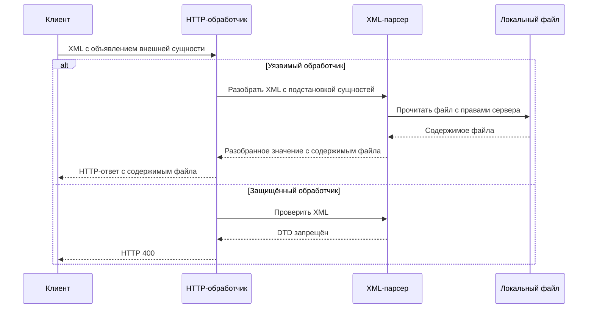
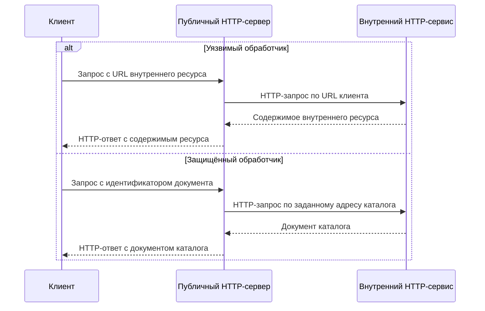

# OWASP Server Security Lab

Локальный учебный стенд для демонстрации SQL injection, command injection, XXE, SSRF и path traversal. Каждый пример содержит уязвимый обработчик и обработчик с защитой. Приложения используют тестовые данные, а Docker публикует их порты только на `127.0.0.1`.

## Запуск

Нужны Docker и Docker Compose. Из каталога `server-vulnerabilities` перейдите в папку нужного примера. Например, для SQL injection выполните:

```bash
cd sqli
docker compose up --build -d
```

У каждого примера свой порт, поэтому их можно запускать одновременно.

- http://127.0.0.1:8081 — SQL injection
- http://127.0.0.1:8082 — command injection
- http://127.0.0.1:8083 — XXE
- http://127.0.0.1:8084 — SSRF
- http://127.0.0.1:8085 — path traversal

## Структура кода

В каждом примере `cmd/server/` запускает HTTP-сервер, `internal/demo/` содержит обработчики, а `compose.yaml` задаёт сервисы и порты. В `sqli/init.sql` находятся начальные данные PostgreSQL, в `xxe/examples/` — учебные XML-документы и тестовый файл для XXE, в `path-traversal/data/` — тестовые файлы для Path Traversal.

## Сценарии

Начните с обычного запроса и сравните ответы обработчиков `/vulnerable/` и `/safe/`.

### 1. SQL injection

Отправьте обычное имя в `GET /vulnerable/users` и `GET /safe/users` через параметр `name`. В защищённом обработчике PostgreSQL получает имя отдельным параметром запроса.

```bash
curl -G http://localhost:8081/vulnerable/users --data-urlencode 'name=alice'
curl -G http://localhost:8081/vulnerable/users --data-urlencode "name=' OR '1'='1' -- "
curl -G http://localhost:8081/safe/users --data-urlencode "name=' OR '1'='1' -- "
```

### 2. Command injection

Передайте имя в `GET /vulnerable/greet` и `GET /safe/greet` через параметр `name`. Защищённый обработчик передаёт имя программе `printf` отдельным аргументом.

```bash
curl -G http://localhost:8082/vulnerable/greet --data-urlencode 'name=Alice'
curl -G http://localhost:8082/vulnerable/greet --data-urlencode "name=Alice'; id; #"
curl -G http://localhost:8082/safe/greet --data-urlencode "name=Alice'; id; #"
```

### 3. XML External Entity Injection (XXE)



Выполняйте команды этого раздела из каталога `server-vulnerabilities/xxe`, чтобы `curl` нашёл файлы в `examples/`. Оба обработчика принимают `examples/normal.xml`. Защищённый обработчик разбирает XML с помощью `encoding/xml` и отклоняет DTD.

```bash
curl http://localhost:8083/vulnerable/xml -H 'Content-Type: application/xml' --data-binary @examples/normal.xml
curl http://localhost:8083/vulnerable/xml -H 'Content-Type: application/xml' --data-binary @examples/xxe.xml
curl -i http://localhost:8083/safe/xml -H 'Content-Type: application/xml' --data-binary @examples/xxe.xml
curl http://localhost:8083/safe/xml -H 'Content-Type: application/xml' --data-binary @examples/normal.xml
```

### 4. Server-Side Request Forgery (SSRF)



Вызовите `GET /safe/import?document=catalog`. Сервер выбирает заранее заданный адрес документа и возвращает содержимое каталога.

```bash
curl -G http://localhost:8084/vulnerable/import --data-urlencode 'url=http://127.0.0.1:9090/public'
curl -G http://localhost:8084/vulnerable/import --data-urlencode 'url=http://127.0.0.1:9090/admin'
curl -G http://localhost:8084/safe/import --data-urlencode 'document=catalog'
curl -i -G http://localhost:8084/safe/import --data-urlencode 'url=http://127.0.0.1:9090/admin'
```

### 5. Path traversal

Запросите `hello.txt` через параметр `name` в `GET /vulnerable/files` и `GET /safe/files`. Защищённый обработчик открывает файл через `os.Root`, который ограничивает доступ каталогом `data/public`.

```bash
curl -G http://localhost:8085/vulnerable/files --data-urlencode 'name=hello.txt'
curl -G http://localhost:8085/vulnerable/files --data-urlencode 'name=../secret.txt'
curl -i -G http://localhost:8085/safe/files --data-urlencode 'name=../secret.txt'
curl -G http://localhost:8085/safe/files --data-urlencode 'name=hello.txt'
```

## Проверка сборки

При сборке Docker-образа выполняются `go test ./...` и `go vet ./...`. Для нативной проверки исходного кода запустите `go vet ./...` из папки примера после установки его зависимостей.

## Управление стендом

Выполняйте команды из папки запущенного примера. Посмотреть состояние контейнеров:

```bash
docker compose ps
```

Посмотреть логи:

```bash
docker compose logs -f
```

Остановить пример:

```bash
docker compose down
```

Чтобы также удалить тома Compose с тестовыми данными, используйте:

```bash
docker compose down -v
```
